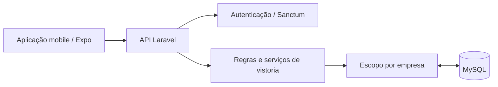

# Atlas Vistorias

### Estrutura para vistorias imobiliárias com API e aplicação mobile

**PHP · Laravel · Sanctum · MySQL · Expo**

Projeto de vistorias imobiliárias com back-end Laravel e estrutura para aplicação mobile. O núcleo documentado reúne autenticação, dashboard, agenda e operações iniciais de vistoria, com organização de dados por empresa.

> Apresentação técnica de um projeto em desenvolvimento. O código-fonte é privado. Documentação pública sem imóveis reais, dados de proprietários, inquilinos, mídias ou credenciais.

## O problema

Uma vistoria precisa manter contexto sobre o imóvel, a data, o responsável e o andamento da operação. Em um sistema utilizado por mais de uma empresa, o acesso também precisa respeitar os limites de cada organização.

## Estrutura da solução

| Núcleo documentado | Responsabilidade |
| --- | --- |
| Autenticação com Sanctum | Acesso à API com tokens |
| Dashboard | Consulta das informações operacionais |
| Agenda por mês e dia | Organização das atividades |
| Listagem, criação e detalhe de vistoria | Fluxo inicial de registros |
| Escopo por empresa | Delimitação dos dados por organização |
| Papéis e permissões | Diferenciar administração e operação |

## Arquitetura

## Decisões técnicas

- **API separada da interface:** permite evoluir os clientes mantendo as regras no servidor.
- **Organização por empresa:** um escopo de dados delimita o acesso dentro do domínio da aplicação.
- **Serviços de domínio:** estados e operações de vistoria possuem responsabilidades próprias.
- **Validação de entrada:** a estrutura do back-end utiliza Form Requests.
- **Evolução por módulos:** agenda, vistorias e módulos complementares podem ser desenvolvidos em etapas.

## Estado e próximos módulos

A documentação consultada distingue o núcleo inicial de funcionalidades ainda planejadas. Upload e processamento de mídias, geração de laudos, assinaturas, comparação de entrada e saída, notificações e partes administrativas constam no planejamento; não são apresentados aqui como funcionalidades concluídas.

O repositório de origem também possui uma referência a um módulo mobile. Esta apresentação descreve a estrutura disponível, sem afirmar que todo o aplicativo ou o fluxo completo de vistoria foi validado.

## O que esta apresentação demonstra

Modelagem de domínio imobiliário, API autenticada, controle de acesso por organização e decomposição de um produto em módulos de evolução.

**Projeto apresentado por [Nycolas França](https://github.com/Scorpped).**
